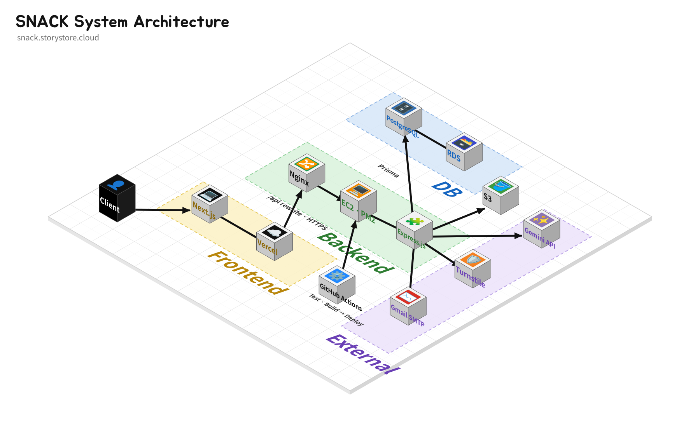

# 🍪 SNACK(스낵) - 원스톱 구매 관리 서비스

<p align="center">
  
</p>

### 🔗 [배포 사이트 바로가기](https://snack.storystore.cloud/)

### 🔗 [Back-end Repository 바로가기]([BE 레포 주소])

<br/>

## 📚 목차

1. [프로젝트 소개](#-프로젝트-소개)
2. [기능 구현 영상](#-기능-구현-영상)
3. [시스템 아키텍처](#-시스템-아키텍처)
4. [기술 스택](#️-기술-스택)
5. [팀원 소개 및 문서](#-팀원-소개-및-문서)
6. [개인별 주요 작업](#-개인별-주요-작업)
7. [프로젝트 구조](#️-프로젝트-구조)
8. [주요 기능](#-주요-기능)

<br/>

## 📑 프로젝트 소개

> **간식 대장, SNACK**
>
> 흩어져 있던 회사 간식·비품 구매를 **요청 → 승인 → 예산 관리** 하나의 흐름으로 묶은 원스톱 구매 관리 서비스입니다.

- **프로젝트 기간**: 2026.08.26 ~ 2026.10.16
- **API 문서 (Swagger)**: [바로가기]([Swagger 주소]/docs)

<br/>

### 🔑 테스트 계정

> 추후 로그인 화면에서 역할별 **게스트 모드**로 바로 둘러볼 수 있도록 개선할 예정입니다.

<br/>

## 📱 기능 구현 영상

> 🚧 **기능 구현 영상은 업데이트 예정입니다.**

<!-- 유튜브 업로드 후 아래 주석을 풀고 VIDEO_ID만 바꿔 주세요
[](https://www.youtube.com/watch?v=VIDEO_ID)
-->

<br/>

## 🚧 시스템 아키텍처

[](./docs/readme/architecture.png)

<br/>

## ⚙️ 기술 스택

<!-- 기술 스택 이미지를 넣으려면 아래 주석을 풀고 파일을 ./docs/readme/tech-stack.png 에 올려 주세요
<p align="center">
  
</p>
-->

### ✔️ Framework & Language

  

### ✔️ State & Data

  

### ✔️ UI & Styling

  

### ✔️ Test & Tools

 

### ✔️ Security


### ✔️ Deploy & Collaboration

   

<br/>

## 👨‍👩‍👧‍👦 팀원 소개 및 문서

### 팀원 소개

|                                                  [역할]                                                   |                                                  [역할]                                                   |                                                   [역할]                                                    |                                                  [역할]                                                  |
| :-------------------------------------------------------------------------------------------------------: | :-------------------------------------------------------------------------------------------------------: | :---------------------------------------------------------------------------------------------------------: | :------------------------------------------------------------------------------------------------------: |
| [](https://github.com/[아이디])<br/>**🦖 박지선** | [](https://github.com/[아이디])<br/>**🐧 최훈민** | [](https://github.com/[아이디])<br/>**💨 하성휘** | [](https://github.com/[아이디])<br/>**🦴 정민주** |

|                                                  [역할]                                                   |                                                  [역할]                                                   |                                                  [역할]                                                   |
| :-------------------------------------------------------------------------------------------------------: | :-------------------------------------------------------------------------------------------------------: | :-------------------------------------------------------------------------------------------------------: |
| [](https://github.com/[아이디])<br/>**🐯 이진태** | [](https://github.com/[아이디])<br/>**🙉 채지훈** | [](https://github.com/[아이디])<br/>**🐼 김서윤** |

### 팀 문서

- [📒 팀 노션 바로가기](https://fringe-door-8de.notion.site/44c72db1b23082b8a0d8015a1d11aa18?v=4a572db1b230835086f788cfc568800f)

### 협업 방식

- **데일리 스크럼**: 매일 진행 상황과 막힌 부분 공유
- **페어 리뷰**: 2인 1조로 서로의 PR을 확인하고 리뷰
- **브랜치 전략**: Merge 권한은 팀장·부팀장, `dev`로는 Squash merge, `dev → main`은 Merge
- **GitHub Projects**: 이슈와 작업 진행 상태를 한 보드에서 관리

<br/>

## 🧑‍💻 개인별 주요 작업

<details>
<summary><b>🦖 박지선</b></summary>

- 랜딩
- 로그인
- 초대
- 회원가입
- 비밀번호 찾기
- 프로필
- 최고관리자 회원관리
- 모달 컴포넌트
- Snacky (AI 어시스턴트) 화면
- Vercel 배포
- README

</details>

<details>
<summary><b>💨 하성휘</b></summary>

- 공통 컴포넌트 (MenuItem, TabMenu, SubCategoryItem, SideMenu)
- 상품 리스트·상세 퍼블리싱 및 등록·수정·삭제 API 연동
- 찜 기능 연결
- 찜 목록 QA (찜 직후 누락, 에러 안내, 다시 시도, 카드 링크 구조)
- 상품 리스트·상세 성능 개선 (서버 선조회)
- 카테고리 상수 및 시드 이미지 정리

</details>

<details>
<summary><b>🦴 정민주</b></summary>

- 공통 컴포넌트 (Button, Toast, Badge)
- 내 구매 요청 내역·상세
- 기업 구매 내역·상세
- 기업 예산 관리 페이지

</details>

<details>
<summary><b>🐯 이진태</b></summary>

- 공통 컴포넌트 (SearchBar, TextField, TextArea, GNB, Profile)
- GNB·Profile 라우트·로그아웃 연동 및 상단 고정
- 장바구니 페이지
- 관리자 예산 잔액 연동
- GNB 장바구니 개수 갱신
- 장바구니 웹 접근성 향상

</details>

<details>
<summary><b>🙉 채지훈</b></summary>

- ProductDetail 컴포넌트
- Dropdown 컴포넌트
- 찜 목록 페이지
- 상품 등록 페이지

</details>

<details>
<summary><b>🐼 김서윤</b></summary>

- 구매 요청 관리·상세
- 구매 요청 승인/반려
- 디자인 시스템 (Typography, Colors, Icon, Image, 레이아웃)
- 공통 컴포넌트 (ProductList, RequestList, MemberList, Pagination, SubCategoryMenu)

</details>

<br/>

## 🏗️ 프로젝트 구조

```
src/
├── app/
│   ├── (auth)/          # 로그인, 회원가입, 초대 가입, 비밀번호 찾기
│   ├── (protected)/     # 로그인 사용자 공통 페이지 (상품, 찜, 장바구니 등)
│   ├── (admin)/         # 관리자 페이지
│   ├── (super-admin)/   # 최고 관리자 페이지
│   ├── layout.tsx
│   └── providers.tsx
├── components/
│   ├── auth/            # RoleGuard 등 권한 컴포넌트
│   ├── icons/
│   └── ui/              # 공통 UI 컴포넌트
├── hooks/               # auth, members, purchase-requests, wishlist, common
├── lib/
│   ├── auth/
│   └── services/        # fetchClient + 도메인별 API 서비스
├── providers/           # Auth, Modal, Query, Toast, Wishlist
├── constants/
├── utils/
└── assets/
```

<br/>

## ✨ 주요 기능

### 역할별 기능

| 역할        | 주요 기능                                                 |
| ----------- | --------------------------------------------------------- |
| 일반 사용자 | 상품 조회·등록, 찜하기, 장바구니, 구매 요청 및 내역 확인  |
| 관리자      | 구매 요청 승인·반려, 즉시 구매, 기업 구매 내역, 예산 확인 |
| 최고 관리자 | 회원 초대·권한 관리, 월 예산 설정                         |

- 관리자·최고 관리자 페이지는 `RoleGuard`로 접근을 막고, 서버에서도 권한을 한 번 더 확인합니다.

### 🚀 심화 기능

**1. 찜하기**

- 상품 상세에서 찜/해제, 찜 목록 페이지에서 모아 보기
- 찜 수를 화면에서 먼저 반영하는 낙관적 업데이트 적용

**2. 회원 초대**

- 최고 관리자가 이메일로 팀원 초대, 받은 사람은 초대 링크로 가입 (유효기간 7일)

**3. 비밀번호 찾기**

- 가입한 이메일로 재설정 링크 발송 (유효기간 30분), 링크에서 새 비밀번호 설정

**4. 매달 예산 자동 생성**

- 매월 1일 서버가 조직별 예산을 자동으로 만들고, 예산 관리 페이지에서 확인

**5. 봇 차단 (Cloudflare Turnstile + Rate Limit)**

- 로그인 실패가 반복되면 로그인 화면에 Turnstile 위젯을 띄워 인증 요구
- 로그인·회원가입·비밀번호 재설정 요청·Snacky에 요청 횟수 제한
- **다음 단계**: 실제 사용자 IP 기준 카운트와 카운트 reset 구현

**6. Snacky (AI 어시스턴트)**

- 서비스 가이드 문서를 근거로 답하는 RAG 기반 채팅 어시스턴트
- 서버는 답변과 함께 참고한 문서 섹션(`sources`)을 반환 (화면 표시는 다음 단계)
- **다음 단계**: 읽기 전용 Tool Calling, Vector DB 확장 등 추가 보완 기능을 통해 SNACK에 맞춘 어시스턴트로 고도화
